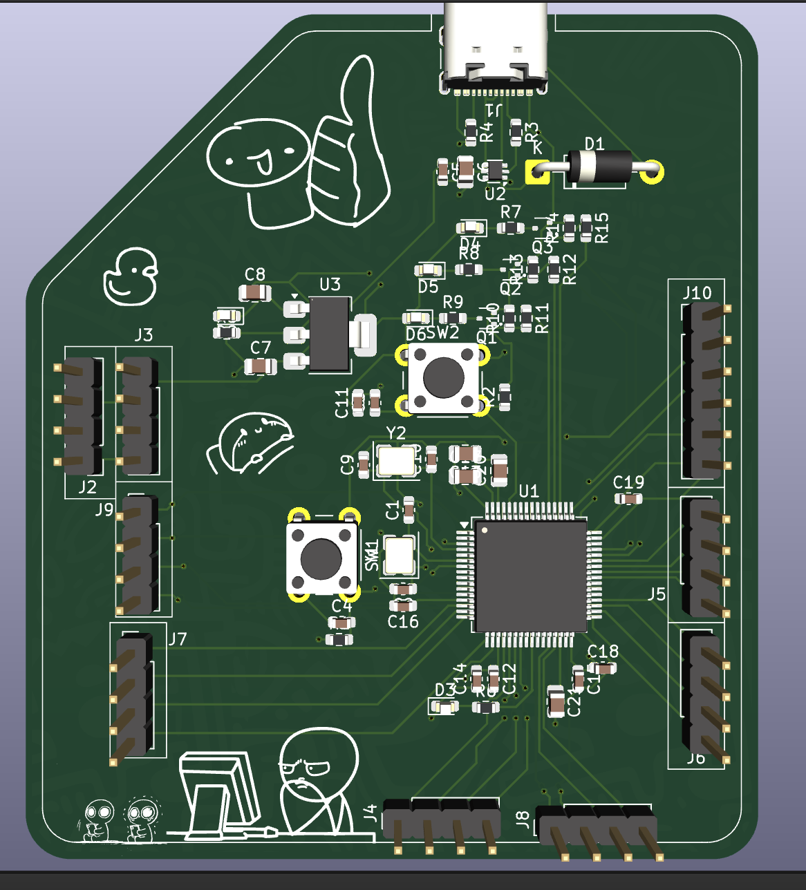
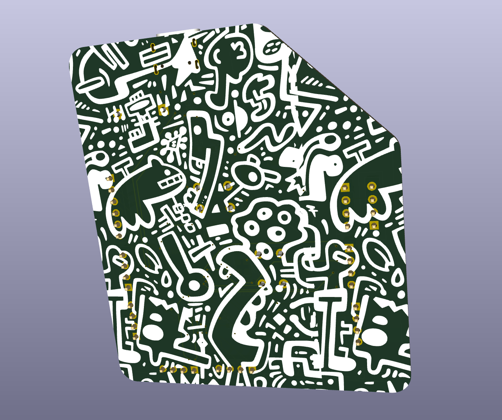
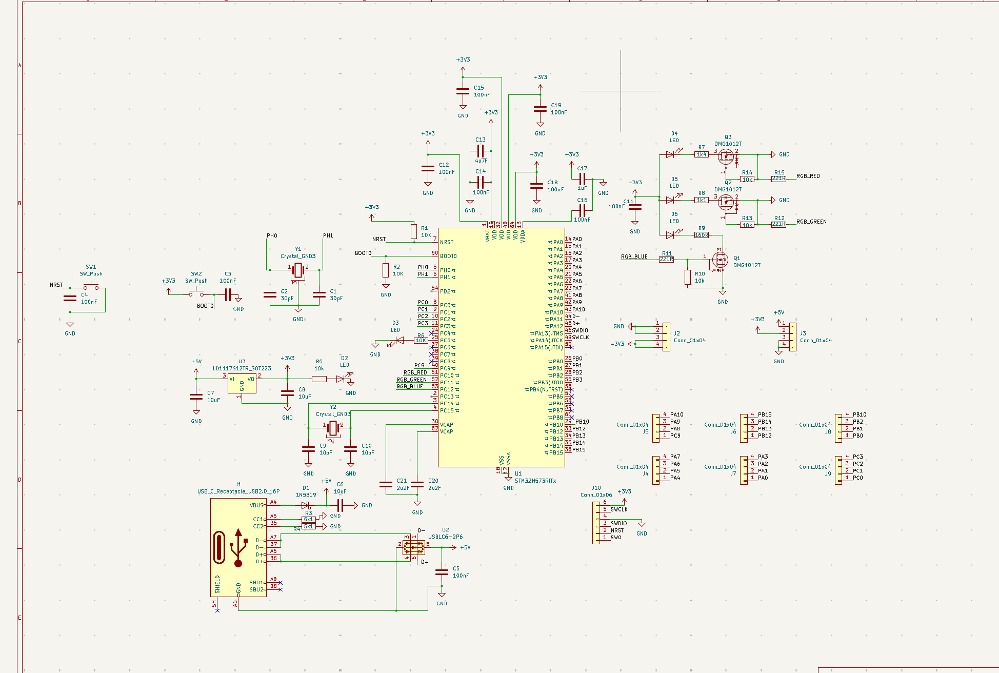
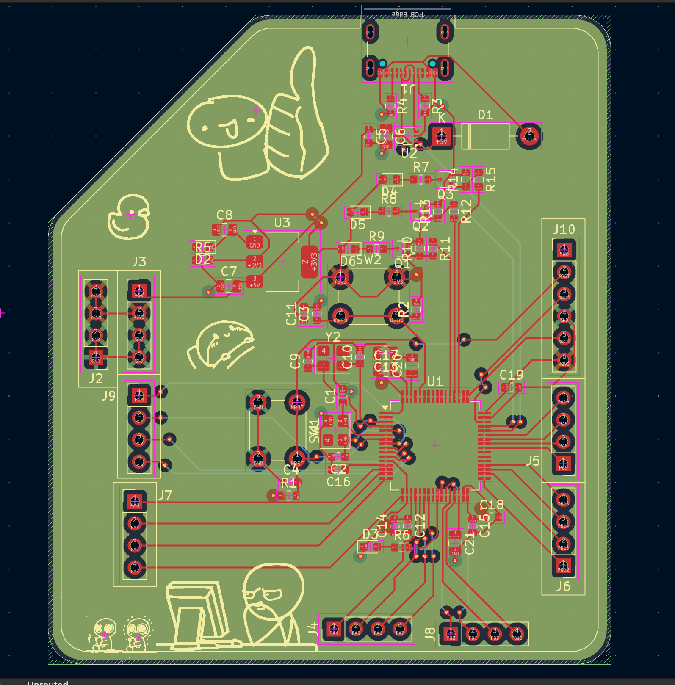

# STM32H573 Development Board

A custom development board based on the STM32H573RIT6 microcontroller, created in KiCad that serves the purpose of learning about the hardware design, PCB layout, power supply and embedded systems.

## Features

### Core components
- Power supply: The board is powered through the USB-C connector. 3.3 V is supplied by the LD1117S33TR regulator.
- Microcontroller: The STM32H573RIT6 processes the firmware code and communicates with peripherals.
- Clock source: 8 MHz crystal serves as an external clock for the microcontroller.
- Pushbuttons and resistors: Used to reset and enter the boot mode.
- USB Protection: USBLC6-2P6 is used for ESD protection of the USB lines.
- Programming and debugging: SWD connector is used for flashing firmware and debugging.
- Headers: Expose some of the pins for expansion.

## The reason behind making this

This board was made by me in order to gain knowledge about how to make an STM32 development board on my own rather than relying on readymade boards available out there.

## Flashing and use

The board is equipped with a USB-C port thus it can be connected to a PC. In case that USB DFU bootloading is set up properly, you may flash the firmware directly via USB and no ST-LINK debugger will be required.

Otherwise, it is still possible to program and debug the board via ST-LINK through the SWD connector.

After flashing the firmware, reboot the board and get started playing around with GPIOs!

## Assembly

The PCB assembly will be done by manually soldering all the parts to the PCB.

## Images

### 3D PCB View — Front

### 3D PCB View — Back

### Schematic

### PCB Routing

## Hardware Design

I have used KiCad to design both the schematic and the PCB.

- `kicad/` — Schematic and PCB design files
- `images/` — Images of PCB rendering, schematic and routing
- `gerber-files/` — PCB manufacturing files
- `bom.csv` — Bill of materials with links to parts
- `grb.zip` — Gerber archive if present

## Bill of Materials

The bill of materials with links to parts is listed in [`bom.csv`](bom.csv)

## BOM

| Qty | Component | Selected Part | Supplier | Link | MOQ | Unit Price (USD) | Order Cost (USD) |
| -------: | ------------- | ----------------- | ------------ | -------- | -------: | --------------------: | -------------------: |
| 100 | 30 pF Capacitor, 0603 C0G | TCC0603COG300J500CT | LCSC | [Link](https://www.lcsc.com/product-detail/C376782.html) | 100 | $0.0042 | $0.42 |
| 20 | Red LED, 0603 | DY-0603SRC-L-SMG | LCSC | [Link](https://www.lcsc.com/product-detail/C524047.html) | 20 | $0.0252 | $0.50 |
| 20 | Schottky Diode, 1N5819 DO-41 | 1N5819 | LCSC | [Link](https://www.lcsc.com/product-detail/C2474.html) | 20 | $0.0367 | $0.73 |
| 10 | 2.2 µF Capacitor, 0805 X7R | CC0805KKX7R7BB225 | LCSC | [Link](https://www.lcsc.com/product-detail/C107128.html) | 10 | $0.0601 | $0.60 |
| 20 | 1 µF Capacitor, 0805 X7R | 0805B105K160CT | LCSC | [Link](https://www.lcsc.com/product-detail/C396719.html) | 20 | $0.0457 | $0.91 |
| 10 | 4.7 µF Capacitor, 0805 X7R | CC0805MKX7R8BB475 | LCSC | [Link](https://www.lcsc.com/product-detail/C5185457.html) | 10 | $0.0717 | $0.72 |
| 50 | 10 pF Capacitor, 0603 NP0 | AC0603JRNPO9BN100 | LCSC | [Link](https://www.lcsc.com/product-detail/C277527.html) | 50 | $0.0106 | $0.53 |
| 5 | 10 µF Capacitor, 0805 X7R | TCC0805X7R106K100FT | LCSC | [Link](https://www.lcsc.com/product-detail/C380346.html) | 5 | $0.0918 | $0.46 |
| 20 | 100 nF Capacitor, 0603 X7R | CC0603JRX7R9BB104 | LCSC | [Link](https://www.lcsc.com/product-detail/C91183.html) | 20 | $0.0209 | $0.42 |
| 50 | Green LED, 0603 | KT-0603G | LCSC | [Link](https://www.lcsc.com/product-detail/C12624.html) | 50 | $0.0124 | $0.62 |
| 50 | Blue LED, 0603 — Backordered | KT-0603B | LCSC | [Link](https://www.lcsc.com/product-detail/C2288.html) | 50 | $0.0104 | $0.52 |
| 1 | USB-C USB 2.0 Connector — Backordered | USB4105-GF-A-060 | LCSC | [Link](https://www.lcsc.com/product-detail/C3025063.html) | 1 | $1.4727 | $1.47 |
| 20 | 1×4 Pin Header, 2.54 mm | PZ254V-11-04P | LCSC | [Link](https://www.lcsc.com/product-detail/C2691448.html) | 20 | $0.0263 | $0.53 |
| 10 | 1×6 Pin Header, 2.54 mm | 2.54-1x6P | LCSC | [Link](https://www.lcsc.com/product-detail/C37208.html) | 10 | $0.0419 | $0.42 |
| 5 | N-Channel MOSFET, SOT-523 | DMG1012T-7 | LCSC | [Link](https://www.lcsc.com/product-detail/C20512.html) | 5 | $0.1019 | $0.51 |
| 20 | 10 kΩ Resistor, 0603 | MCT06030C1002FP500 | LCSC | [Link](https://www.lcsc.com/product-detail/C161803.html) | 20 | $0.0377 | $0.75 |
| 10 | 5.1 kΩ Resistor, 0603 | HoAR0603-1/10W-5.1KR-0.1%-TCR25 | LCSC | [Link](https://www.lcsc.com/product-detail/C5123587.html) | 10 | $0.0728 | $0.73 |
| 20 | 1.4 kΩ Resistor, 0603 | RT0603BRD071K4L | LCSC | [Link](https://www.lcsc.com/product-detail/C705740.html) | 20 | $0.0596 | $1.19 |
| 10 | 1.1 kΩ Resistor, 0603 | RT0603BRD071K1L | LCSC | [Link](https://www.lcsc.com/product-detail/C705736.html) | 10 | $0.0508 | $0.51 |
| 1 | 160 Ω Resistor, 0603 — Backordered | ERJP03F1600V | LCSC | [Link](https://www.lcsc.com/product-detail/C543226.html) | 1 | $0.0598 | $0.06 |
| 1 | 221 Ω Resistor, 0603 — Backordered | ERJ-S03F2210V | LCSC | [Link](https://www.lcsc.com/product-detail/C2113629.html) | 1 | $0.0270 | $0.03 |
| 5 | USB ESD Protection, SOT-666 — Backordered | USBLC6-2P6 | LCSC | [Link](https://www.lcsc.com/product-detail/C15999.html) | 5 | $0.2491 | $1.25 |
| 5 | 3.3 V LDO Regulator, SOT-223 | LD1117S33TR | LCSC | [Link](https://www.lcsc.com/product-detail/C86781.html) | 5 | $0.2467 | $1.23 |
| 5 | 8 MHz Crystal, 18 pF, SMD3225 | 0132M4-8.000F18DTNL | LCSC | [Link](https://www.lcsc.com/product-detail/C51949868.html) | 5 | $0.1920 | $0.96 |
| 1 | STM32H573RIT6 Microcontroller — Backordered | STM32H573RIT6 | LCSC | [Link](https://www.lcsc.com/product-detail/C22371377.html) | 1 | $9.9787 | $9.98 |
| 50 | 6×6 mm Tactile Switch | SH-6X6X5H-STM | LCSC | [Link](https://www.lcsc.com/product-detail/C22383475.html) | 50 | $0.0115 | $0.58 |
| 1 | PCB Fabrication | Custom STM32H573 PCB | JLCPCB | [JLCPCB](https://jlcpcb.com/) | 1 | $8.00 | $8.00 |
| | Total cost | | | | | | $34.63 |